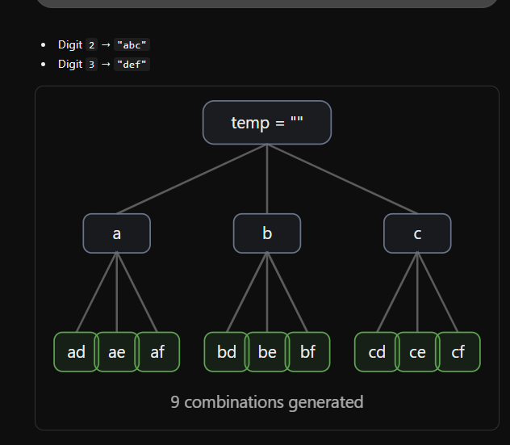

# Letter Combinations of a Phone Number

Given a string of digits from 2 to 9, choose one letter for each digit and return every possible combination.

For `digits = "23"`, digit 2 gives `abc` and digit 3 gives `def`.

The answer is `ad, ae, af, bd, be, bf, cd, ce, cf`.

## Recursion tree



Each level handles one digit. Each branch chooses one of that digit's letters.

## My code

```cpp
class Solution {
public:
    void find(string digits, vector<string>& ans,
              vector<string>& maping, string temp, int index) {

        if (index == digits.size()) {
            ans.push_back(temp);
            return;
        }

        int position = digits[index] - '2';

        for (int i = 0; i < maping[position].size(); i++) {

            find(digits, ans, maping,
                 temp + maping[position][i], index + 1);
        }
    }

    vector<string> letterCombinations(string digits) {

        vector<string> ans;

        if (digits.size() == 0) {
            return ans;
        }

        int index = 0;
        string temp;

        vector<string> maping(8);

        maping[0] = "abc";
        maping[1] = "def";
        maping[2] = "ghi";
        maping[3] = "jkl";
        maping[4] = "mno";
        maping[5] = "pqrs";
        maping[6] = "tuv";
        maping[7] = "wxyz";

        find(digits, ans, maping, temp, index);

        return ans;
    }
};
```

This is the LeetCode-style code. A standalone C++ file also needs `<string>`, `<vector>`, and the appropriate `std::` names or `using namespace std;`.

## Why subtract '2'?

```cpp
int position = digits[index] - '2';
```

Our mapping starts with the letters for digit **2 at index 0**. We need to turn digits 2 through 9 into positions 0 through 7.

`digits[index]` is a character, such as `'3'`. The code subtracts the **character `'2'`**, not the integer `2`.

Digit characters have consecutive character codes. Subtracting `'2'` tells us how far the current digit is from `'2'`.

| Digit character | Calculation | Position | Letters |
|---|---|---|---|
| `'2'` | `'2' - '2'` | 0 | abc |
| `'3'` | `'3' - '2'` | 1 | def |
| `'4'` | `'4' - '2'` | 2 | ghi |
| `'5'` | `'5' - '2'` | 3 | jkl |
| `'6'` | `'6' - '2'` | 4 | mno |
| `'7'` | `'7' - '2'` | 5 | pqrs |
| `'8'` | `'8' - '2'` | 6 | tuv |
| `'9'` | `'9' - '2'` | 7 | wxyz |

For example, in ASCII, `'3'` has code 51 and `'2'` has code 50. So `51 - 50 = 1`, and `maping[1]` gives `"def"`.

You can also think of it as two steps:

```cpp
int digit = digits[index] - '0'; // Character '3' becomes number 3
int position = digit - 2;       // Number 3 becomes mapping index 1
```

Both approaches give the same position. Using only `digits[index] - '0'` would give 3 for `'3'`, which is the wrong index for this eight-entry mapping. Using `digits[index] - 2` would subtract 2 from the character code, which is also wrong.

**Remember: the first valid digit is 2, but the first vector index is 0.**

## How the recursion works

1. `index` tells us which digit we are handling.
2. `position` finds that digit's group of letters.
3. The loop tries each letter in that group.
4. `temp + maping[position][i]` builds a new string with the chosen letter.
5. `index + 1` moves to the next digit.
6. When `index == digits.size()`, we have chosen one letter for every digit, so we save `temp`.

For `"23"`, start with `temp = ""`. Choose `a` for 2, then try `d`, `e`, and `f` for 3, saving `ad`, `ae`, and `af`. After those calls return, try `b`, then `c` for the first digit. This produces all nine answers shown in the screenshot.

`index` and `position` do different jobs: for `digits = "79"` at `index = 0`, the current digit is `'7'`, so `position = 5` and the letters are `"pqrs"`.

## Understanding the two square brackets

```cpp
maping[position][i]
```

`maping[position]` selects a string, such as `"def"`. The second `[i]` selects one character inside that string. For example, `maping[1][0]` is `'d'` and `maping[1][2]` is `'f'`.

`vector<string> maping(8)` creates one vector containing eight strings. The parentheses set its size; square brackets access an element. `vector<string> maping[8]` would instead declare an array of eight vectors, a different type.

## Why no pop_back()?

`temp` is passed by value, and concatenation creates a new string for the next call. The parent's string stays unchanged, so there is nothing to undo after returning.

The empty-input check returns an empty answer instead of a list containing an empty string. The code assumes all nonempty input characters are from `'2'` to `'9'`, as required by the problem.

## Time and space

For `n` digits, there are at most `4^n` combinations, each of length `n`. Worst-case time is `O(n * 4^n)` and storing the answers takes `O(n * 4^n)` space.

The recursion depth is `O(n)`. In this exact version, `digits` and `temp` are copied at each call, so auxiliary space along a recursion path can be `O(n^2)`, excluding the answers.
